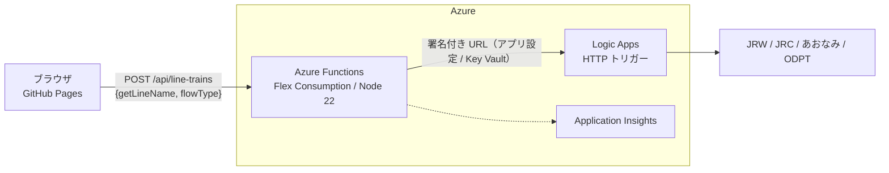

# 中継 API（Azure Functions）

列車走行位置ビューアのブラウザと Logic Apps の間に置く中継 API です。
**Logic Apps の署名付き URL（`sig=`）をブラウザに出さない**ことが、主な目的です。

## 構成



| 層 | 役割 |
|---|---|
| ブラウザ（`re-content.js`） | 画面側のキャッシュ・クールダウン・タイムアウト（既に実装済み） |
| **Functions（このフォルダ）** | Origin 確認、許可リスト検証、レート制限、結果キャッシュ、署名付き URL の秘匿 |
| Logic Apps | 各社 API の取得（従来どおり）。**キーを再生成し、新しい URL は Functions にだけ設定する** |

### Functions が行う保護

| 保護 | 内容 | 実装 |
|---|---|---|
| 許可リスト | `flowType` と `getLineName` の組み合わせが、画面の路線定義にあるものだけを上流へ転送する（64 件） | `src/lib/allowlist.ts` |
| 結果キャッシュ | 同じ路線は 30 秒間キャッシュ。同時リクエストは上流呼び出しを 1 回にまとめる。上流が落ちたら 5 分まで古い結果を返す | `src/lib/cache.ts` |
| レート制限 | 1 IP あたり 30 回／分（超過は 429 と `Retry-After`）。XFF は偽装できる左端ではなく右端を使用 | `src/lib/rateLimit.ts` |
| Origin 確認 | 許可した Origin（GitHub Pages）以外のブラウザからの呼び出しを 403 にする | `src/lib/handler.ts` |
| 入力検証 | メソッドは POST のみ、Content-Type は JSON、本文は 1 KB まで、型・内容を厳密に確認 | `src/lib/handler.ts` |
| 情報漏えい防止 | 上流のエラーは利用者に詳細を返さず（502 のみ）、ログにも署名付き URL を出さない | `src/lib/upstream.ts` |
| 上流の保護 | タイムアウト 15 秒、応答サイズの上限 2 MB | `src/lib/upstream.ts` |

> **上流への呼び出し回数の上限**：キャッシュが路線ごとに 1 つのため、1 インスタンスあたりの上流呼び出しは、
> 最大でも「64 路線 ÷ 30 秒」に収まります。攻撃されてもこれ以上は増えません。

### 認証レベルを `anonymous` にしている理由

ブラウザに関数キーを持たせても、ページのソースから誰でも取得できる「公開された鍵」になります。
`function` レベルにしても保護にならず、運用の手間だけが増えるため、上表の多層防御で守る設計です。
利用者を限定したい場合は、App Service の組み込み認証（Easy Auth）を併用してください。

## フォルダ構成

```
functions/
├── host.json                       Functions ホスト設定
├── local.settings.sample.json      ローカル用設定のひな形（コピーして local.settings.json にする）
├── package.json / tsconfig.json
├── src/
│   ├── functions/lineTrains.ts     HTTP トリガー（POST /api/line-trains）
│   └── lib/                        allowlist / cache / rateLimit / upstream / handler / config
└── test/                           単体テスト（node:test）
```

## アプリ設定

| 名前 | 必須 | 既定 | 説明 |
|---|---|---|---|
| `LOGIC_APP_URL` | ✅ | — | 再生成後の Logic Apps の署名付き URL。**Key Vault 参照を推奨** |
| `ALLOWED_ORIGINS` | ✅ | — | 許可する Origin（カンマ区切り）。例：`https://<account>.github.io` |
| `CACHE_TTL_SECONDS` | | 30 | 結果を再利用する期間 |
| `STALE_IF_ERROR_SECONDS` | | 300 | 上流が失敗したときに、古い結果を返してよい期間 |
| `RATE_LIMIT_PER_MINUTE` | | 30 | 1 IP あたりの 1 分間の上限 |
| `UPSTREAM_TIMEOUT_MS` | | 15000 | 上流の応答を待つ最大時間 |

## ローカルで動かす

前提：Node.js 20 以上、[Azure Functions Core Tools v4](https://learn.microsoft.com/azure/azure-functions/functions-run-local)、ストレージエミュレーター（Azurite）。

```powershell
cd functions
npm install
npm test                                  # 単体テスト（18 件）
Copy-Item local.settings.sample.json local.settings.json   # LOGIC_APP_URL などを書き換える（コミットしない）
npm start                                 # http://localhost:7071/api/line-trains
```

```powershell
curl.exe -X POST http://localhost:7071/api/line-trains -H "Content-Type: application/json" -d '{\"getLineName\":\"1\",\"flowType\":\"Toei\"}'
```

## Azure へのデプロイ（Azure CLI の例）

Azure Functions のベストプラクティスに沿って、**Flex Consumption プラン**を使います（Linux 専用）。
値の `<...>` は置き換えてください。オプション名は `az` のバージョンで異なる場合があるため、`az functionapp create --help` で確認してください。

```powershell
$rg   = "rg-trainpos"
$loc  = "japaneast"
$st   = "sttrainpos<unique>"          # 小文字・数字のみ、3〜24 文字、全体で一意
$app  = "func-trainpos-<unique>"
$kv   = "kv-trainpos-<unique>"

az group create --name $rg --location $loc

# 1. ストレージ（Functions の内部用）
az storage account create --name $st --location $loc --resource-group $rg --sku Standard_LRS --allow-blob-public-access false

# 2. Function App（Flex Consumption / Node 22 / 512 MB / 最大 5 インスタンス）
az functionapp create --resource-group $rg --name $app --storage-account $st `
  --flexconsumption-location $loc --runtime node --runtime-version 22 `
  --instance-memory 512 --maximum-instance-count 5

# 3. マネージド ID と Key Vault（署名付き URL をアプリ設定に直接書かない）
az functionapp identity assign --resource-group $rg --name $app
az keyvault create --name $kv --resource-group $rg --location $loc --enable-rbac-authorization true
# → Function App の ID に「Key Vault Secrets User」ロールを付与し、シークレット logic-app-url を登録する

# 4. アプリ設定
az functionapp config appsettings set --resource-group $rg --name $app --settings `
  "LOGIC_APP_URL=@Microsoft.KeyVault(SecretUri=https://$kv.vault.azure.net/secrets/logic-app-url/)" `
  "ALLOWED_ORIGINS=https://<account>.github.io"

# 5. CORS（プラットフォーム側。許可する Origin だけにする）
az functionapp cors add --resource-group $rg --name $app --allowed-origins "https://<account>.github.io"

# 6. 公開
cd functions
npm ci && npm run build
func azure functionapp publish $app
```

追加で設定することを推奨します。

- **Application Insights**：Function App 作成時に自動で付けるか、`az monitor app-insights component create` で作成して接続する。
- **予算アラート**：ポータルの「Cost Management → 予算」で、月額の上限（例：500 円）とメール通知を設定する。
- **Logic Apps 側**：アクセスキーを再生成し、**新しい URL を Key Vault にだけ保存する**。ワークフローの先頭でも `flowType` / `getLineName` の許可リスト検証を入れておく（二重の防御）。

## 画面側の切り替え

Functions を公開したら、画面側を次のように変更します（**変更前に Functions が動いていること**を確認してください）。

1. [re-content.jsx](../re-content.jsx) の `LINE_INFO_ENDPOINT` を Functions の URL に置き換える。
   ```js
   const LINE_INFO_ENDPOINT = "https://func-trainpos-<unique>.azurewebsites.net/api/line-trains";
   ```
   リクエスト本文（`{ getLineName, flowType }`）とレスポンスの形は、そのまま互換です。
2. [index.html](../index.html) の CSP の `connect-src` を、新しい接続先に変える。
   ```
   connect-src https://func-trainpos-<unique>.azurewebsites.net
   ```
3. `npm run build:jsx` で `re-content.js` を再生成し、GitHub Pages に反映する。

エラー時は、画面に次のメッセージが出ます（`403` Origin 不一致、`429` レート制限、`502` 上流の障害）。

## 路線を追加したとき

`re-content.jsx` の `*AreaLine` に路線を追加したら、`src/lib/allowlist.ts` にも同じ `flowType` と `code` を追加してください。
追加を忘れると、その路線は 400（`unknown_line`）になります（`test/lib.test.ts` に確認例があります）。

## 料金の目安

利用者が十数人（例：15 人 × 1 日 100 回 × 30 日 ≒ 4.5 万回／月）の場合の概算です。
キャッシュにより、Logic Apps の呼び出しは、これより大幅に少なくなります。
**価格は変更されます。見積もりは Azure の料金計算ツールで確認してください。**

| 項目 | 目安 |
|---|---|
| Functions（Flex Consumption） | 月 25 万回の実行と 10 万 GB 秒までが無料（サブスクリプション単位）。4.5 万回 × 約 0.3 秒 × 0.5 GB ≒ 6,750 GB 秒で、**無料枠内** |
| ストレージアカウント | 月数十円程度 |
| Application Insights | 取り込み量が月 5 GB 未満なら無料枠内（サンプリング有効） |
| Key Vault | 1 万操作あたり数円。ほぼ 0 円 |
| Logic Apps（従量課金） | 1 アクションあたり約 0.000025 ドル。キャッシュで呼び出しが減る分、**現状より安くなる** |
